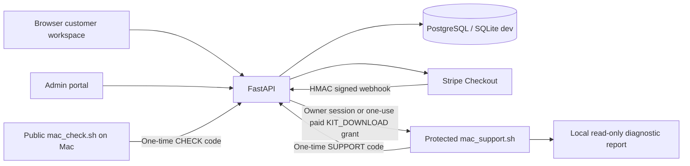

# AHT Revive — architecture

## Identity and authorization

- `User`: authenticated customer or server-promoted administrator; Argon2 password hash.
- `DeviceRecord`: HMAC-SHA256 `serial_hash` unique per device, `serial_suffix`, model, chip and runtime OS metadata; user registration. It does not store the full serial.
- `RecoveryCase`: specific device, requested support, owner, human-review state and messages. Existing data model preserves the keyed `serial_hash` for device association.
- `FeasibilityReview`: independent specialist-reviewed `PENDING`, `ELIGIBLE` or `INELIGIBLE` state and notes per case; approval only permits the described read-only support service. It does not establish MDM bypass compatibility.
- `DeviceAccessGrant`: random 256-bit bearer token, SHA-256 at rest, case/user/stage bound, expires in 15 minutes and is consumed once. Stages are CHECK, KIT_DOWNLOAD, or SUPPORT.
- `Order`: server-priced, case-bound Stripe purchase. Confirmed PAID status is recognized across that customer's cases for the same serial fingerprint.
- `AuditEvent`: administrative review, code issuance, stage authorization, and script delivery.

## Endpoint protection matrix

| Action | Requirement |
|---|---|
| Register a Mac | Logged in, CSRF and ownership attestation, unique keyed serial record |
| Free check script download | None |
| Issue CHECK code | Signed-in case owner; CSRF, bounded issuance |
| Query payment/eligibility | One-time CHECK code + case ID + matching full serial; never serial-only |
| Start checkout | Case owner + human ownership verification + specialist feasibility approval |
| Mark order PAID | Valid Stripe webhook, expected amount/currency/session/order and idempotency |
| Download advanced kit | Authenticated owner OR one-use handoff code, plus ownership verified, technically eligible, not closed, PAID |
| Issue SUPPORT code | Same paid entitlement + CSRF |
| Run advanced diagnostics | One-time SUPPORT code + case/serial match + recheck current paid, ownership and feasibility state |

## Trust boundaries

The Mac scripts are **not attested or tamper-proof**. A user can alter the client-supplied serial; the backend only verifies that it matches the previously registered case fingerprint. Eligibility is a workflow decision and does not imply guaranteed device compatibility, secure-boot modification, or an official Apple Business Manager release.

Script downloads embed only the configured public APP_URL, no API secret. Public script files are not copied under `app/static`. The advanced script is streamed from an access-controlled route and never embedded in the free script. The paid checker response contains a short-lived KIT_DOWNLOAD code and an expected SHA-256 digest; the checker offers to fetch the kit and verifies its digest, without executing it automatically. Its source can be viewed by a paying recipient; no client-side secrecy can prevent this.

## Production requirements

Migrate schema with Alembic; use TLS; limit API abuse by IP/account in a shared store; verify customer emails; implement admin MFA; provide audit/retention; implement Stripe refund and dispute entitlement revocation; consider an authenticated Mac desktop agent with cryptographic device identity if stronger hardware identification is necessary. No active device enrollment bypass is implemented.
